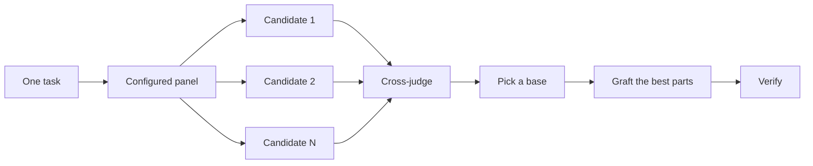

# Design before you write code

One attempt at a hard design locks in the first shape the model thought of. `/architect` settles types and boundaries before implementation. `/arena` runs several attempts at the same brief and merges the best parts. `/interrogate` has other models try to break the result. When the job is coverage rather than design synthesis, `/cloud-swarm` (or local `invoke_subagent` fan-out for 8 or fewer workers) fans out slices or races and aggregates their results.

The two most common design mistakes are taking the agent's first design and polishing a plan that no code has tested. This page fixes both. You plan through code. Prototypes answer the open questions, a README or tutorial sets the target, and the written plan comes last.


## Settle the shape with `/architect`

```text
/architect design the import pipeline before writing any code. i care most about how callers use it.
```

[`/architect`](../../skills/architect/SKILL.md) traces every system the change touches first, running `/how` over touched code and `/why` when moving ownership or layers. Then it sketches competing shapes, each with caller usage written first, followed by types, signatures, and module boundaries, and picks the shape where each piece of state has one owner, each task has one way to run, and callers need to know least. For a large or contested design, it runs `/arena` instead of sketching alone.

By default it proceeds straight from the synthesized design into implementation. If you want to inspect the design before code starts, say so in the prompt.

```text
/architect with checkpoint. stop and show me before implementing.
```

The design is not sacred once code starts. If the same workaround keeps coming back, `/architect` redesigns instead of patching around it.

## Fan out attempts with `/arena`

```text
/arena take my prompt to the arena verbatim. i want to compare their proposals with yours.
```

[`/arena`](../../skills/arena/SKILL.md) is the general tool underneath. N subagents attempt the same design or code brief in parallel, each writing to its own worktree or isolated path. A read-only cross-judge pool scores every candidate against a rubric. The coordinator reads each candidate end to end, picks a base, grafts in the strongest parts from the losers, and verifies the result.



The panel comes from your [`/setup-agystack`](../../skills/setup-agystack/SKILL.md) configuration in `agystack-models.md` (`inherit`, `flash`, `pro`), and you can adjust the count per task. Ask for more candidates when the decision matters, and fewer when it does not.

```text
/arena this, 5 candidates. the cache key format is expensive to change later.
```

## Cover slices and races with `/cloud-swarm`

```text
/cloud-swarm check every package under packages/ against its check.sh. one worker per package. one report.
```

[`/cloud-swarm`](../../skills/cloud-swarm/SKILL.md) fans more than 8 workers across Google Cloud Run for independent slices, coverage matrices, gauntlet lanes, exploration partitions, or declared race arms. For 8 or fewer workers, agystack uses local `invoke_subagent` fan-out instead, and for agents collaborating on a shared board it leaves Antigravity's native `/swarm` unshadowed. Each worker gets its own scope and check, then reports `PASS`, `ISSUES`, or `BLOCKED`. The parent waits for the workers and returns one compact report with any gaps or dropouts.

Reach for it when parallelism buys coverage or lets independent checks race. `/arena` gives every worker the same design or code brief, then picks a base and grafts the best parts. `/cloud-swarm` covers slices or runs a race with a selection rule declared up front, without base selection or grafting.

## Break it with `/interrogate`

```text
/interrogate the whole branch, but skeptically. no nitpicks unless it's an actual bug or regression.
```

[`/interrogate`](../../skills/interrogate/SKILL.md) sends the diff, stated intent, and rubric to concurrent reviewers across configured model tiers (`pro`, `flash`, `inherit`). Diverse tiers surface different blind spots. Every actionable finding must include an executable repro command, and the coordinator reruns each repro command via `run_command`. Speculative findings that fail to reproduce against the codebase are dropped. The coordinator writes `adversarial_review.md` sorting surviving findings into `Act on`, `Consider`, `Noted`, and `Dismissed` (the dropped findings with justification), and applies nothing automatically.

Read the `Dismissed` (dropped) list too. The lead verifier applies pragmatic engineering judgment rather than infallibility, and you can override any dismissal.

## Prototype instead of debating

Never take the first design. Ask for a few, and pick from evidence you can see.

```text
/poteto-mode prototype a few options for the new dropdown menu. take screenshots or videos for me to compare.
```

The [Prototype playbook](../../skills/poteto-mode/playbooks/prototype.md) builds throwaway sketches in a scratch directory, puts the variants behind one switcher, drives each one, and captures screenshots or timings into `prototype_review.md`. It also works for behavior and algorithms, not just UI. Prototypes are planning with code. They let the agent answer open questions by running something instead of asking you, and they leave room for an option you would not have invented up front.

The same idea scales up to a real design. Pair `/architect` with prototypes and keep a review gate.

```text
/poteto-mode we need rate limiting for external webhooks. /architect it first, and answer open questions with prototypes. let me review before proceeding.
```

Do not spend adversaries on an abstract plan. `/interrogate` drops every finding that a live run does not prove, so a plan with no code behind it gives reviewers nothing to break. Let prototypes settle the questions, then review what got built.

## Write the README first for shared code

For a package or API that other code will use, start with the doc a user would read.

```text
/poteto-mode write a tutorial for how i would use the new config package first. then /teach me why it beats the current one.
```

Writing the tutorial first forces the caller's view. You describe the API to a hypothetical user and work back to the implementation. The doc also becomes a concrete target the agent checks its own work against. Name [`/technical-writing`](../../skills/technical-writing/SKILL.md) when the doc itself matters, so a tutorial stays a tutorial instead of drifting into reference and explanation at once.

## Plan after the design settles

agystack has no standalone planning skill because Antigravity already provides native `implementation_plan.md` artifacts. When you want a written multi-PR plan, ask for it once the design settles.

```text
/poteto-mode turn this design into a plan. small verifiable PRs, each with its own verification steps.
```

The [Multi-phase plan playbook](../../skills/poteto-mode/playbooks/multi-phase-plan.md) settles any remaining open questions by prototype, writes one section per PR (each ending in concrete verification receipts, checked with `node skills/poteto-mode/scripts/check-plan.mjs`), and stops at the `implementation_plan.md` deliverable. A passing test suite alone does not count as proof. Execution starts only when you say go.

For a migration, state the bar in the prompt.

```text
/poteto-mode plan the migration of our ui library to the new styling system. small verifiable PRs, each with visual regression checks. the result must match the original exactly, bugs included.
```

`"bugs included"` keeps the migration from quietly changing behavior along the way, which would make old and new outputs impossible to compare. For a multi-day project, you can commit the plan to the repo temporarily so other agents see the work in progress, then delete it when the work lands.

## How much design work does a task deserve?

Most changes need none of this. Use this rough ladder when deciding how far to go.

- A small, finished change you are unsure about needs `/interrogate` alone.
- A change that crosses function boundaries or moves ownership earns `/architect`, which brings `/arena` when the design is large or contested.
- A standalone decision where independent attempts help, such as naming, formats, or an algorithm, uses `/arena` directly.
- A coverage matrix, set of parallel checks, or race with declared arms uses local `invoke_subagent` fan-out (`<= 8` workers) or `/cloud-swarm` (`> 8` workers).
- An open question you could answer by running something, such as layout, timing, or behavior, gets a prototype instead of a debate.
- A contested design that is expensive to reverse gets `/architect`, then `/interrogate` before shipping.
- Work that spans several PRs gets a plan written after the design settles.

`/poteto-mode` already applies this ladder. Boundary-crossing work triggers `/architect` on its own, so reach for these directly mainly when you want more or less scrutiny than the default.

Next, [Build and clean the change](./05-build-and-clean.md).
