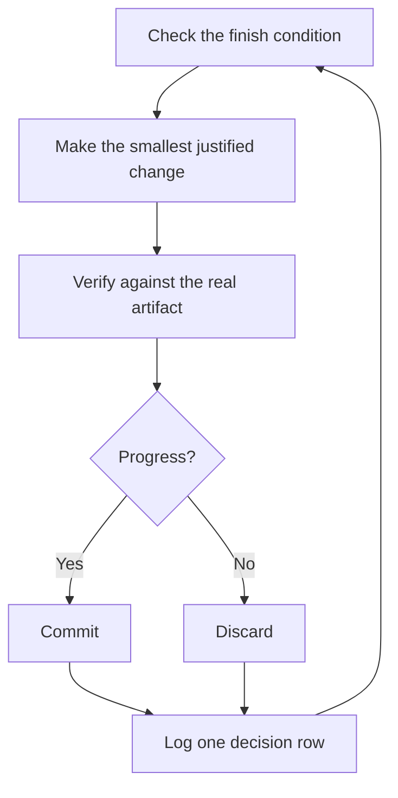

# Run work while you sleep

This is the payoff for everything before it. An agent you can trust to verify its own work is an agent you can leave alone with a hard task. What makes that safe is not hope. It is a checkable finish condition, an isolated worktree or Cloud Run worker, and a decision log you audit in the morning.


## Earn the trust before the loop

A loop you do not trust just produces unchecked work faster, and the mess compounds with every iteration. Before you leave one running, check that it has earned that autonomy.

- You have done the task once by hand, or watched an agent do it, so you know what good looks like.
- The agent has the tools and signals you would use yourself, such as the verification skill, the profiler, and the logs.
- Every stage proves its work and can stop the line when the work misses the bar.
- You have read several transcripts and turned repeated failures into tools, skills, or checks.

Make the loop autonomous only after all four hold. Until then, run it while you watch.

## The overnight contract

A good handoff has the goal, the finish condition, permissions, and an escape hatch. It does not need to be long.

```text
/poteto-mode im going to bed. migrate every caller to the new parser in a fresh worktree off <base>.
done means zero old callers, all parser fixtures pass, old api deleted.
keep a decision log. don't ask me before committing.
/goal run until done. if you're truly stuck after a few hours, stop and write up why.
```

Walk through what each line buys you.

- `"im going to bed"` is a session override. The agent stops asking on reversible steps and keeps going.
- `"done means..."` turns the goal into checks every iteration can run.
- `"fresh worktree off <base>"` keeps the run from colliding with anything else you have open.
- `"don't ask me before committing"` pre-answers the permission the agent would otherwise block on.
- `/goal` paired with Antigravity's `schedule` tool drives overnight runs and periodic audit ticks under the [Autonomous run playbook](../../skills/poteto-mode/playbooks/autonomous-run.md), delivering `walkthrough.md` and `decisions.tsv` as receipts.
- Keep [`/loop`](../../skills/loop/SKILL.md) strictly for inner-loop verification hillclimbs (`--verify "<command>"`, 10 iterations by default, stopping when the command exits `0`). Do not send standing overnight runs or PR audit ticks through `/loop`; those belong on `/goal` plus `schedule`.
- The escape hatch lets the agent stop at a genuine dead end and write up why, which beats eight hours of creative goal reinterpretation.

Because you will review this work after stepping away, `/poteto-mode` routes it through [`/figure-it-out`](../../skills/figure-it-out/SKILL.md), which designs the run's phases before any code and wires in the decision log.

To stop a run on purpose, tell the agent to pause, or that you are going offline or restarting Antigravity. The [Pause safely playbook](../../skills/poteto-mode/playbooks/pause-safely.md) finishes or backs out of the current atomic step, commits a `wip:` checkpoint on the current branch, and writes `resume_checkpoint.md`. A fresh chat picks the work up from that note through the [Session pickup playbook](../../skills/poteto-mode/playbooks/session-pickup.md). Saying `"keep going"` never triggers a pause.

## What the loop does all night



One change, one check, one log row, every iteration. Changes that did not help get discarded, not left to ride. A plateau means pivot, not stop, and the finish condition never quietly relaxes to declare victory.

## The morning audit

[`/show-me-your-work`](../../skills/show-me-your-work/SKILL.md) is what makes the run reviewable. Each row records the timestamp, phase, decision, reason, an evidence pointer, and the result in an append-only TSV at `decisions.tsv` inside `<appDataDir>/brain/<conversation-id>/` (or `.audit/<task-slug>.tsv` when several runs share a repo). It stays local by default. Commit a copy only when the work is ambitious enough that an external reviewer needs the trail to trust the result.

When you return, ask for the run in review form.

```text
/show-me-your-work catch me up on what you did last night
```

Before the skill hands back its summary, it dispatches a reviewer on a distinct model tier to audit the trail against the transcript, and the reply ends with an `Attention` section listing what deserves your scrutiny. Read that section first, then inspect the log rows it points at. You are auditing decisions, not re-reading the whole night.

For a quick status instead of a full trail audit, run [`/ketchup`](../../skills/ketchup/SKILL.md) in the chat that ran the work. It keeps the turn strictly read-only, summarizes what changed since your last message in under 100 words alongside native artifact visuals (`carousel` blocks and screenshots), and lists every decision waiting on you (about 30 words per item) with its pick, evidence, and risk so you can decide from the reply alone.

## When the night holds a queue, not a task

The contract above drives one task to one finish condition. Some nights hold more, such as a queue of independent changes or a multi-day program. Three playbooks scale the same trust up.

[Autopilot-full](../../skills/poteto-mode/playbooks/autopilot-full.md) runs a queue of independent PRs to merged. Each PR gets one `poteto-agent` owner carrying build through merge, and no owner merges on its own verdict. A verification swarm proves the code-ready head live, while rebases or minor fixes get a single fresh verifier (`git patch-id` preserves valid lanes across pure rebases). Only a clean verdict authorizes the merge via `gh` (or `origin pr`).

```text
/poteto-mode full autopilot on this queue. each item is independent. i want them merged by morning.
```

[Autopilot-stack](../../skills/poteto-mode/playbooks/autopilot-stack.md) runs the same owner loop without merging. You wake up to one linear stack built on parent PR branches via `gh pr` or `origin pr` (Graphite tracking is optional only), with a verifier's verdict on every link, and you review and land it yourself. Pick it over Autopilot-full when changes are coupled or when you want your own eyes on the code before anything merges.

```text
/poteto-mode autopilot these five changes, but stack them, don't ship. i'll land the stack in the morning.
```

[Orchestrate](../../skills/poteto-mode/playbooks/orchestrate.md) handles programs that outlive any single agent (multi-day, many stacked PRs, dozens of subagents under one standing coordinator chat). The coordinator authors briefs, drains completions, keeps the lowest unmerged PR green, and never edits code itself. If one agent could finish the work inside a single session, Orchestrate routes you back to the overnight contract above.

```text
/poteto-mode orchestrate the store migration. own it until every package is converted and merged. i'll check in twice a day.
```

When you automate staged triage, repro, and fix passes on a recurring `schedule`, keep two rules intact. Every stage can stop the line when a report fails to reproduce or looks too risky, and every stage hands over concrete evidence (screenshots, logs, and before-and-after proof) so a human can check intent before reading code.

**Pitfall.** A duration is not a finish condition. `"work on this for 4 hours"` gives the agent nothing to check, and you will wake up to motion instead of a result. Give `/goal` a checkable predicate or artifact, and give `/loop` a `--verify` command that exits `0` on success.

Next, [Steer with principle names](./08-principles.md).
