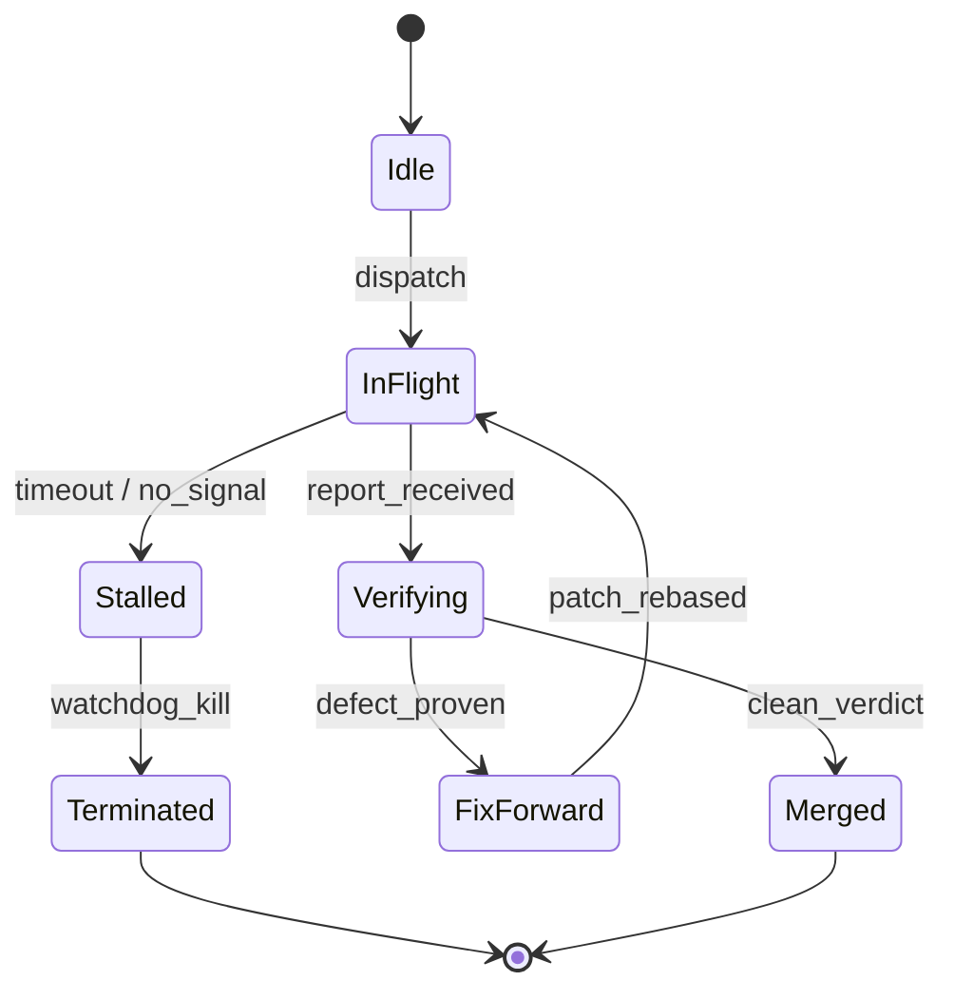

# Statechart

Model system states, transitions, invariants, and failure modes using native Mermaid state diagrams. Use for complex lifecycle flows, state synchronization, distributed race analysis, or when validating stateful protocol behavior.

## Core Modeling Invariants

1. **Enumerate Explicit States.** Distinguish legitimate reachable states from illegitimate or zombie states.
2. **State Invariants.** For each state, define the assertions that must hold true while the system remains in that state.
3. **Transitions and Triggers.** Identify explicit events, timeouts, and inputs that trigger transitions between states.
4. **Identify Failure and Crash Paths.** Model crashes, aborts, and retries at every transition boundary.
5. **Find Shortest Failure Path.** Analyze the shortest sequence of events leading from the initial state to an invalid or unhandled failure state.

## Native Mermaid State Diagram Artifacts

Render models directly as native Mermaid `stateDiagram-v2` or `flowchart TD` blocks within Brain Artifacts (`<appDataDir>/brain/<conversation-id>/statechart_<slug>.md`). Avoid external compilers or heavyweight Java/TLC tooling.

### Example Schema

````markdown

````

## Verification Checklist

- Are all error transitions terminal or explicitly handled by reconciliation?
- Is there any transition where an illegitimate state can reach steady state?
- Does the shortest failure path have an automated test reproducing it?
